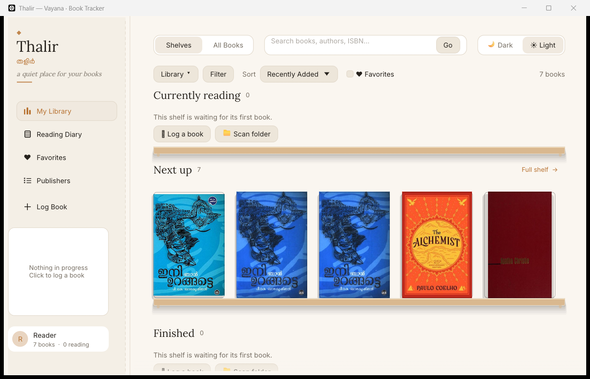
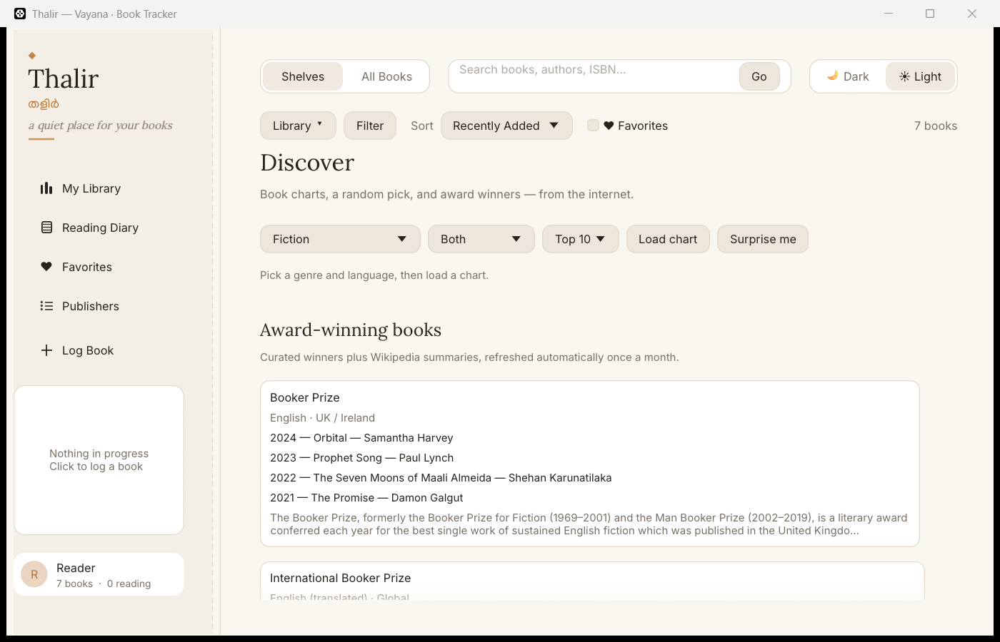
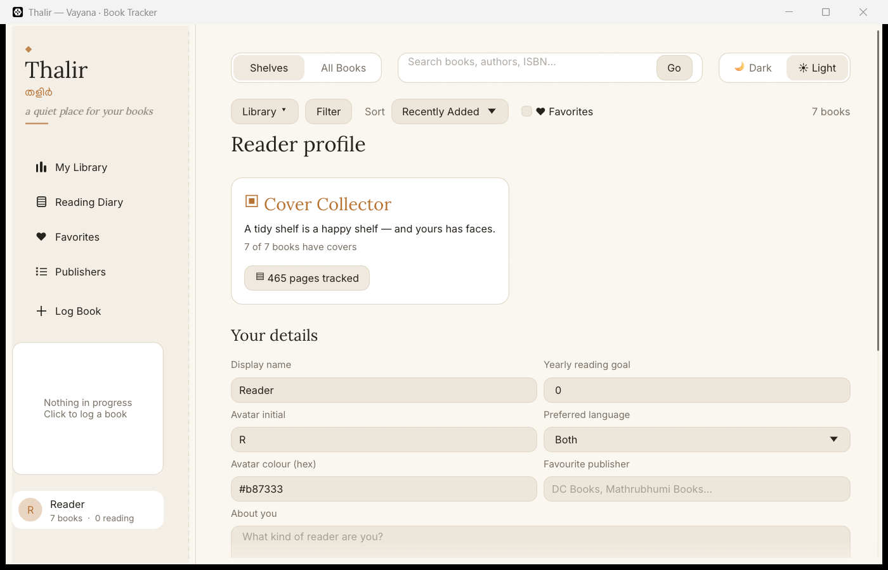

# KathaShelf

[](https://www.rust-lang.org/)
[](LICENSE)
[](README.md#quick-start)
[](CONTRIBUTING.md)

**A quiet, local-first bookshelf for Malayalam & English readers.**

KathaShelf is a desktop book tracker built entirely in Rust with
[eframe/egui](https://github.com/emilk/egui) and
[rusqlite](https://github.com/rusqlite/rusqlite). There is no web server, no
Node.js, and no cloud account — your library, notes, and covers stay on your
machine. The interface is called **Thalir** (തളിർ).



---

## Why KathaShelf?

- **Made for bilingual shelves.** English and Malayalam titles live side by side,
  with bundled Lora, Inter, and Manjari fonts — no runtime font downloads.
- **Your data stays yours.** SQLite + a local `covers/` folder. Offline after the
  first import.
- **No UI freeze.** Search, cover downloads, and folder scanning all run on
  background threads and stream results back to the UI.
- **One polished surface.** Warm Paper / Cozy Night themes, tactile shelves,
  responsive poster grid, and a compact 240px sidebar.

---

## Features

### Build your library
- Track title, optional Malayalam title, author, publisher, ISBN, status,
  half-star rating (0.5–5.0), review, bookmark note, finish date, and page
  progress.
- **Global search** across Google Books, Open Library, and a Goodreads HTML
  fallback, with source badges, deduplication, and cover-first ranking.
  Selecting a result fills the whole form and downloads the cover.
- **VLC-style folder scanning** for `.epub` and `.pdf` files: watched folders,
  rescan, editable import review, embedded cover extraction, and duplicate
  detection by path or title+author.
- Double-click an imported book to open the source file in your system viewer.

### Discover something new
- Spotify-style **top 10 / 20 / 25** charts by genre and language.
- **Surprise me** random pick from any chart.
- Award-winning books from Booker, Pulitzer, Jnanpith, Kerala Sahitya Akademi,
  Sahitya Akademi, and more, with monthly-refreshed Wikipedia summaries.

### Understand your reading
- A playful **reader archetype** (e.g. *Malayalam Monsoon Reader*, *Cover
  Collector*, *Half-Star Mystic*) derived from your library.
- Editable profile, badges, stats, local recommendations, and a
  "find more like this" action.

### Details that matter
- Markdown-friendly reviews with live preview.
- Inline bookmark editor for the currently reading book.
- Cover paste (clipboard / URL / local file), generated placeholders, and
  auto-fetched covers.
- Escape / backdrop / Cancel all close dialogs cleanly.

---

## Quick start

### Requirements
- Rust stable ([rustup.rs](https://rustup.rs))
- A C compiler (for bundled SQLite): MSVC build tools or MinGW-w64 on Windows,
  Xcode CLT / GCC / Clang on macOS/Linux

### Build from source

```bash
git clone https://github.com/vishn0o/KathaShelf.git
cd KathaShelf
cargo build --release
```

The executable is `target\release\kathashelf.exe` on Windows. Release builds use
`windows_subsystem = "windows"`, so no terminal window appears.

```bash
cargo run          # debug build, keeps console output
cargo test         # 16 unit tests
```

Prebuilt binaries are available on the [Releases](../../releases) page.

---

## Screenshots

| Library shelves | Discover charts | Reader profile |
|---|---|---|
|  |  |  |

---

## Project structure

```text
src/
  main.rs        # entry point, eframe setup, fonts
  app.rs         # egui UI, state, modals, background-thread polling
  db.rs          # schema, migrations, CRUD, filters, profile
  covers.rs      # cover download, downscale, cache, cleanup
  openlibrary.rs # Google Books / Open Library / Goodreads, charts, Wikipedia
  scan.rs        # EPUB/PDF folder scanner
  awards.rs      # curated literary awards
  reader.rs      # reader archetype, badges, stats
  models.rs      # Book, Profile, validation helpers
assets/          # bundled Lora, Inter, Manjari fonts
docs/            # screenshots and database reference
```

See [docs/DATABASE.md](docs/DATABASE.md) for the full SQLite schema and
migration notes.

---

## Data & privacy

Everything is stored under the OS application-data directory:

| OS | Location |
|---|---|
| Windows | `%APPDATA%\KathaShelf\KathaShelf\data\` |
| macOS | `~/Library/Application Support/com.KathaShelf.KathaShelf/` |
| Linux | `~/.local/share/KathaShelf/` |

The folder contains `books.sqlite3`, WAL sidecars, a `covers/` cache, and
`prefs.txt` for the theme. Libraries created by the earlier **KadhaShelf** name
are detected automatically and reused.

Network access only happens when you explicitly search, import a scanned book
without an embedded cover, or refresh award data. Nothing is uploaded.

---

## Contributing

Contributions are welcome — see [CONTRIBUTING.md](CONTRIBUTING.md) for the
workflow and quality gates (`cargo fmt`, strict clippy, tests).

## License

Released under the [MIT License](LICENSE).
